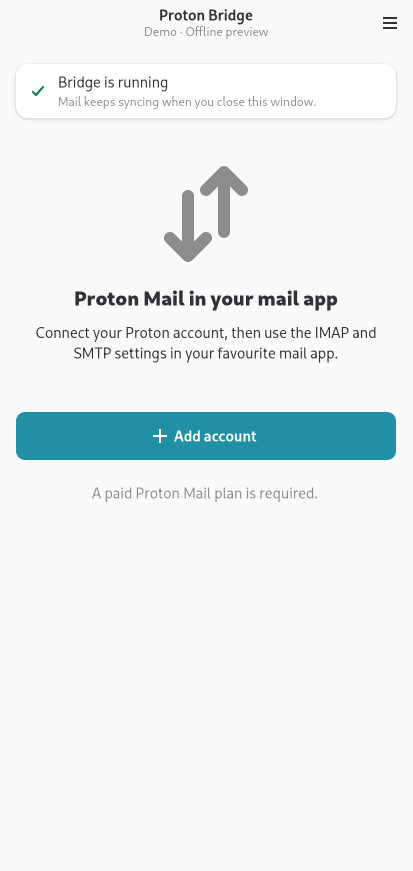
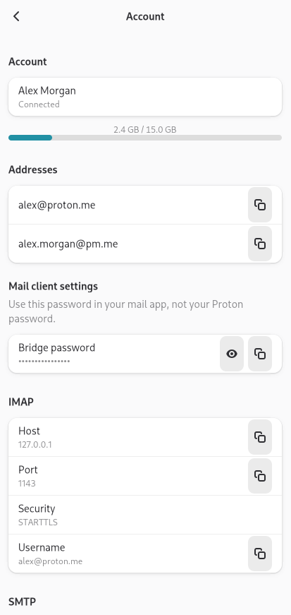
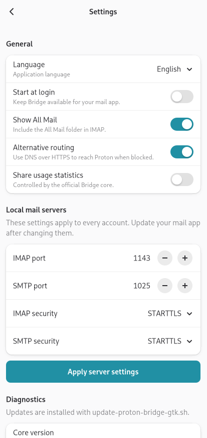
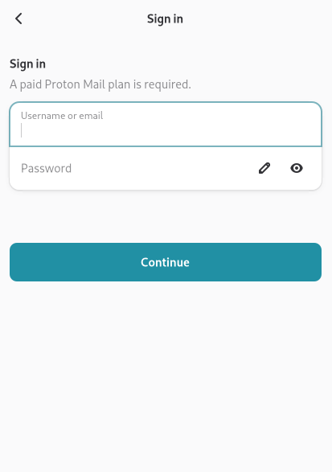

# Proton Bridge (GTK)

An unofficial native GTK4 + libadwaita interface for
[Proton Mail Bridge](https://github.com/ProtonMail/proton-bridge), made for Linux
phones, including the **FuriLabs FLX1s running FuriOS 14 (Phosh, aarch64)**.

Bridge connects a **paid Proton Mail account** to a local IMAP/SMTP mail client.
This is a Bridge control interface; read and send mail in a separate client such
as Evolution or Thunderbird. The official Proton Go core handles authentication,
encryption, synchronisation, the credential vault and the local mail servers.
The GTK interface replaces Qt and communicates over upstream's authenticated,
certificate-pinned local gRPC API. **No changes to the upstream core are needed.**

| Welcome | Mail client settings | Settings | Sign in |
|:--:|:--:|:--:|:--:|
|  |  |  |  |

All screenshots were captured on FLX1s in English using the explicit offline
demo. They contain no real accounts or credentials.

- A native touch-friendly interface that fits 360-pixel-wide windows.
- Multiple accounts, connection status, storage usage and sync progress.
- Sign-in, TOTP two-factor authentication, separate mailbox password, USB FIDO2
  security keys and PIN prompts; browser-based human verification when required.
- IMAP/SMTP host, port, TLS mode, email address and Bridge-generated password;
  copy buttons and password reveal. Copied passwords expire after 45 seconds
  if the clipboard still contains that password.
- Combined or split address mode, sign-out and removal with confirmation.
- Autostart, All Mail, alternative routing, usage statistics, server ports and
  TLS settings; logs and TLS certificate export.
- Closing the window keeps Bridge running. **Quit Bridge** stops the mail servers.
- English, German, Spanish, French, Italian, Portuguese (Brazil) and Russian.
  The language follows the system locale or the choice in Settings → Language.

## Build and install on FLX1s

On the build machine: Linux, `podman`, `git`, `ssh`, `tar`, `find`, and GNU
coreutils. No local Go or Qt installation is required. On the phone: Python 3.13,
PyGObject, GTK **4.12+**, libadwaita **1.5+**, `libsecret-1-0`, `libfido2-1`,
`libcbor0.10`, OpenSSL 3, an unlocked **GNOME Keyring / Secret Service**, and apt
access for the Python gRPC/Protobuf packages. FuriOS 14 provides the GTK libraries
and keyring. SSH key authentication must work.

```bash
./update-proton-bridge-gtk.sh                 # build and install on PHONE=furios
./update-proton-bridge-gtk.sh --build-only    # produce an arm64 directory in out/
./update-proton-bridge-gtk.sh --ui-only       # update the UI using the existing core
./update-proton-bridge-gtk.sh --check         # compare this checkout with the phone
./update-proton-bridge-gtk.sh --force         # rebuild the core
./update-proton-bridge-gtk.sh --uninstall     # keep accounts, vault and cached mail
```

Set `PHONE=furios@192.168.1.10` if you do not have a `furios` SSH alias.
The build container uses Debian 13 so its glibc requirement is below FuriOS 14's.
Go downloads the toolchain required by upstream's `go.mod`. The first build
downloads the compiler, dependencies and container; subsequent builds reuse them.
Python gRPC, Protobuf and their c-ares/re2/Abseil dependencies are extracted from the phone's apt packages into the
application directory, without sudo. GTK and the secret service use system libraries.

The tested upstream version is pinned in `upstream-version` (currently `v3.27.1`).
`--tag vX.Y.Z` opts into a different upstream version and regenerates its protocol
bindings; a new version needs testing. The script refuses to overwrite local
changes in `upstream/`. `--check` compares the pinned core and this interface's
revision, rather than silently adopting an untested release.

The installed application lives in `~/.local/share/proton-bridge-gtk`, with a
desktop entry in the app list. The core uses Proton's standard directories:

| Contents | Directory |
|---|---|
| Encrypted vault and RPC config | `~/.config/protonmail/bridge-v3` |
| Mail cache and process lock | `~/.cache/protonmail/bridge-v3` |
| Mail database and upstream logs | `~/.local/share/protonmail/bridge-v3` |
| Core startup diagnostics | `~/.local/state/proton-bridge-gtk/core.log` |

XDG directory overrides are respected. **Do not run the official Qt/CLI Bridge
alongside this interface**: both use the same core data and process lock.
The encrypted vault is managed by upstream, and Proton passwords are never saved
by the GTK frontend. Account changes affect the shared upstream vault.

## Connect a mail client

1. Open **Proton Bridge (GTK)** and add a paid Proton Mail account.
2. Open the account to see its local **IMAP** and **SMTP** settings.
3. Configure your mail client with those settings and the **Bridge password**,
   which differs from your Proton account password. The usual defaults are
   `127.0.0.1:1143` (IMAP) and `127.0.0.1:1025` (SMTP), using STARTTLS.
4. If asked, trust Bridge's local TLS certificate in that client. Certificate
   export includes `key.pem`; keep it private.
5. Enable **Start at login** if you want the core to start in the background.

In split address mode choose the address in the account screen and configure each
one separately in your mail client. Changing address mode or server settings
requires updating the client configuration.

## Development and verification

```bash
./update-proton-bridge-gtk.sh --build-only
./tools/test.sh
python3 tools/check_repository.py
```

Tests exercise real TLS and token authentication against a local test RPC server,
Unicode password encoding, and the actual GTK widget tree under a headless X
server: 360px layout, account details, server validation, sign-in event transitions,
window close/background behaviour and disconnection. Native screenshots are
written to `out/screenshots/`.

An offline preview is available from the installed directory:

```bash
~/.local/share/proton-bridge-gtk/proton-bridge-gtk --demo
~/.local/share/proton-bridge-gtk/proton-bridge-gtk --demo empty
PROTON_BRIDGE_GTK_OPEN=settings ~/.local/share/proton-bridge-gtk/proton-bridge-gtk --demo
```

`PROTON_BRIDGE_GTK_OPEN` accepts `account`, `login`, or `settings` for visual QA.
Demo mode never contacts Proton and rejects submitted login details locally.

## Languages and project presentation

Documentation, source comments, desktop metadata, commit messages and published
screenshots are in English. Translated application strings are stored separately
in `gtk-ui/proton_bridge_gtk/locales/`. The JSON catalogs use Unicode escapes
(`ensure_ascii=True`) so the resource files themselves contain only ASCII text.
At runtime they are decoded into the selected language, including Russian.

Choose **Settings → Language**, or use `--language en` for a single launch.
The preference is kept in `~/.config/proton-bridge-gtk/preferences.json`. The
**System default** option respects `LC_ALL`, `LC_MESSAGES`, `LANGUAGE` and `LANG`,
falls back from regional locales to their language, and uses English for an
unsupported language. The command-line override does not modify the saved choice.

The pinned upstream Bridge source has English QML strings and no shipped
translation catalogs. These translations belong to this GTK frontend; they are
not presented as official Proton translations. GTK's own dialogs follow the
desktop's locale.

To add a language, copy `locales/en.json`, translate every value, save it with
ASCII Unicode escapes, and register the locale in `i18n.LANGUAGES`. Translation
tests verify complete catalogs, UI string coverage and locale selection.

Capture presentation screenshots with `tools/screenshots.py --output <directory>`
using the installed launcher's Python and library paths. This script forces
`LC_ALL=C.UTF-8`, `LANGUAGE=en` and the application's English language. It uses
the offline demo exclusively and regenerates every image in `docs/screenshots/`.

The arm64 binary and real empty-account startup are verified on FLX1s. The login
state transitions are tested using local events; real Proton account sign-in,
mail sync/send, physical FIDO keys and human verification require an account/device
and are not claimed as end-to-end tested. If a server error prevents startup,
unlock the keyring and inspect `core.log`. Upstream's automatic signed Qt updates
are disabled for this distribution; update with the script above.

## Project layout

- `gtk-ui/proton_bridge_gtk/`: Python/PyGObject frontend, RPC transport and matching
  generated protocol bindings.
- `build-env/`: Debian cross-compilation container; no Qt.
- `packaging/`: launcher, desktop entry and original SVG icon.
- `tests/`, `tools/`: transport and native UI verification.
- `upstream-version`: supported upstream tag. `upstream/`, `.cache/`, and `out/`
  are local build products excluded from Git.

## Publishing on GitHub

Commit this wrapper repository, including the generated Python protocol, sources,
packaging, screenshots and licensing files. The build script fetches the upstream
core separately. Do not commit `upstream/`, `out/`, runtime account data, logs,
certificates, tokens or credentials. CI builds the arm64 distribution and runs
the local transport and native UI checks. The release directory contains both
license files and the exact `UPSTREAM_TAG` / `CORE_REVISION`.

When distributing binaries, also provide this repository and the exact upstream
source revision under the GPL, including the build instructions. The original
Proton launcher/signature-based updater is not part of this distribution.

## License

GNU General Public License **v3 or later**, see [LICENSE](LICENSE) and
[NOTICE](NOTICE). This project is not affiliated with or endorsed by Proton AG.
